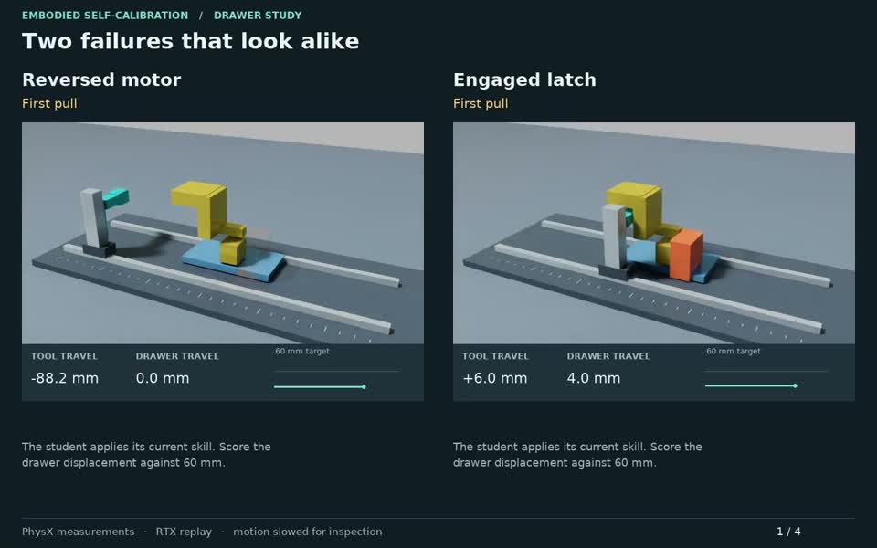

# Research progress

**November 14, 2026 · DGX Spark.** [Read the six-page paper](paper/embodied-self-calibration.pdf) · [Watch the narrated paper walkthrough](videos/15-paper-walkthrough.mp4) · [Editable manuscript](paper/manuscript.typ) · [Daily research review](#recurring-research-review)

**Latest milestone · independent walking.** The 12-actuator teacher and 8-actuator student walked in free-base MuJoCo simulation. In the primary test, Qwen never requested a contact demo. In the separate costed-query test, a measured foot-height lesson raised independent mastery from 2/12 to 10/12 and reduced capped practice from 5.17 to 2.50 trials. A fixed request reproduced the gain. [Watch the narrated walking experiment](videos/17-cross-body-walking.mp4) · [Paired results, costs and limits](#cross-body-locomotion-results)

**Manipulation and reaching.** Across eight hidden drawer conditions, 32B and the fixed rule both taught students that passed all three fresh starts in every condition. The rule used six teacher demonstrations and four motor probes; 32B used twelve demonstrations and seven probes. The 8B supervisor passed five of eight episodes. On the held-out reaching grid, a threshold fitted on a two-link arm matched 8B's 39/48 successes on a three-link arm with 54 fewer probes. All online student tests were in simulation. [Earlier 81-second briefing on milestones 1–8](videos/research-briefing.mp4)

| Milestone | Film | Finding | Recorded trials |
| --- | --- | --- | --- |
| 1 · Physics and student learning | [Two failures that look alike](videos/01-physics.mp4) | Rule selected a diagnostic probe for reversed motion and a teacher segment for the latch. Both frozen skills passed all three starts, 6/6 total. | [PhysX rule](results/drawer-rule.json) |
| 2 · Live Qwen | [When the teacher stops too soon](videos/02-raw-qwen.mp4) | With raw measurements, Qwen stopped early and passed 0/6. It described backward motion as successful even though the drawer stayed closed. | [Raw Qwen](results/drawer-qwen.json) |
| 3 · Explicit task score | [Does a clearer observation help?](videos/03-evidence.mp4) | After adding signed direction and a goal-met field, Qwen passed 3/6. It acquired the correct polarity but also requested an unnecessary teacher segment. In the latch case, it kept practicing and exhausted the budget. | [Qwen with derived score](results/drawer-qwen-observed.json) |
| 4 · Combined and absent faults | [Two faults together, or none at all](videos/04-transfer.mp4) | Frozen Qwen and the rule each passed 6/6. Qwen used the same probe-then-demo sequence it used on the reversed-only trial. Success on both faults alone gives weak evidence that Qwen isolated the latch. | [Qwen](results/transfer-qwen-observed.json) · [Rule](results/transfer-rule.json) |
| 5 · Independent physics engine | [Does the failure survive a new engine?](videos/05-cross-engine.mp4) | ODE reimplemented the drives, constraints and collision response. On the original pair, Qwen again passed 3/6, with all failures on the latch. The rule passed 6/6. | [ODE Qwen](results/ode-qwen-observed.json) · [ODE rule](results/ode-rule.json) |
| 6 · Agent call timing | [One student, two ways to call Qwen](videos/06-call-schedule.mp4) | On the shifted fixtures, scheduling cut model calls from 13 to 7. Frozen-student success fell from 9/12 to 6/12. The scheduled agent used zero teacher demonstrations and missed the combined fault. | [Every decision, paired](results/shifted-qwen-observed-paired.json) · [combined/nominal](results/shifted-qwen-observed-transfer.json) · [scheduled, paired](results/shifted-qwen-scheduled-paired.json) · [combined/nominal](results/shifted-qwen-scheduled-transfer.json) |
| 7 · Learn “10 cm left” | [Two-link and three-link arms](videos/07-ten-centimetres.mp4) | Both frozen motor maps passed 6/6 posture tests. Qwen used nine probes across the two bodies. Probing each channel once used five and reached the same final errors (3.0–8.4 mm). With zero calibration, all six errors remained 100 mm. | [Qwen](results/reach-qwen.json) · [All channels](results/reach-all_channels.json) · [Untrained](results/reach-untrained.json) |
| 8 · Workspace stress test | [How far does one calibration transfer?](videos/08-workspace.mp4) | Across 208 posture/direction pairs, one frozen map passed 102. Refitting at each posture passed 166. The three-link arm improved from 41/104 to 85/104. | [All paired outcomes](results/workspace-sweep.json) |
| 9 · Decide when to recalibrate | [Is this motor map still useful?](videos/09-recalibrate.mp4) | Qwen chose to reprobe on every one of 48 trials. It passed 39, using 144 extra pulses and 48 resets. The two-link residual threshold passed 39 with 90 pulses and 30 resets. Keeping the original map passed 24. | [Decisions, evidence and both simulated outcomes](results/recalibration-switch.json) |
| 10 · Transfer the right teacher segment | [A rotary teacher and a sliding student](videos/10-cross-body-teacher.mp4) | Matching object-motion segments passed 9/9 starts. Cyclically shuffled segments passed 0/9, a fixed lift passed 3/9, and a plain pull passed 0/9. This intervention isolates demonstration content, with the query supplied by the evaluator. | [Teacher observations and 36 student trials](results/keyed-teacher.json) |
| 11 · Integrated teaching test | [When does the student get the right lesson?](videos/11-teaching-decisions.mp4) | With unseen gate heights and a rotary teacher, Qwen passed 5/8 teaching episodes (15/24 starts). It never requested a demonstration on a normally mapped keyed drawer. The fixed rule passed 8/8 episodes (24/24 starts). | [Qwen3-8B](results/integrated-qwen-observed.json) · [Rule](results/integrated-rule.json) |
| 12 · Real teacher data | [Three physical DROID drawer demonstrations](videos/12-real-teacher.mp4) | A gripper-state trigger fired in one of the first three selected drawer episodes. In the other two, the recorded gripper state stayed constant while the drawer visibly opened. Qwen will need an object-motion observation to query these cases reliably. | [Selection and measured traces](results/droid-drawer-sample.json) · [Footage attribution and scope](experiments/droid/README.md) |
| 13 · Noisy teacher observations | [How accurately must the student see the teacher?](videos/13-observation-errors.mp4) | A three-frame median before peak detection gained 21 and lost 6 of 108 starts at 4 mm frame noise. With noiseless observations and −6 mm bias it lost all nine starts. | [Paired observations and executed starts](results/teacher-observation-errors.json) |
| 14 · Paired checkpoint comparison | [Does the larger model choose a better lesson?](videos/14-model-size.mp4) | 32B passed 8/8 episodes with 32 model calls and 12 demos. At the normally mapped 34 mm gate it asked four times and never practiced the resulting skill before the budget expired. The frozen skill still passed. | [All 32B prompts, decisions and measured runs](results/integrated-qwen32.json) · [Matched aggregate](paper/model-results.json) |
| 15 · Six-page research paper | [74-second walkthrough with narration and captions](videos/15-paper-walkthrough.mp4) | The manuscript reports matched/shuffled teacher controls, the two model sizes, fixed-rule costs, local motor maps, a DROID audit, and sensitivity to measurement error. | [Six-page PDF](paper/embodied-self-calibration.pdf) · [Rebuild instructions](paper/README.md) |
| 16 · Continuing cross-host replication | [Latest observation traces and cumulative outcomes](videos/16-daily-replications.mp4) | The GitHub-hosted run uses the registered physics task and new noise seeds. Each film refresh shows the latest measured example and accumulated paired wins and losses. | [Raw follow-up runs](results/replications) · [Current counts](#recurring-research-review) |
| 17 · Cross-body locomotion | [Can another robot shorten walking practice?](videos/17-cross-body-walking.mp4) | A separate costed query led Qwen to request eight measured strides. With the correct foot-height phases students mastered 10/12 runs; swapping hind labels yielded 2/12. The original single-menu supervisor never asked. | [Learning curves and costs](results/locomotion-summary.json) · [Scored replay poses](results/locomotion-replay.json) |

**Reading the films.** The early drawer films replay measured simulator poses with RTX lighting. The later engineering views show hinge centres, trajectories, or a cross-section through the catch. Qwen sees measurements. Cause labels, geometry, and aggregate test scores are for the viewer. All online student evaluations are simulated. Milestone 12 audits previously recorded physical teacher demonstrations. The second engine is native ODE, independent of Isaac PhysX. Webots and real hardware remain unevaluated.

**Limits.** Each drawer skill stores polarity and a lift target. The reaching student stores a local motor map. Both start with an engineered action menu, calibrated measurements, and repeatable resets. Three final starts in an episode share one learned skill. They measure robustness to starting state and do not provide three independent estimates of teaching quality.

## Combined-fault protocol

After running the two single-fault fixtures, freeze the observation adapter, prompt, student update rules, budgets, teacher script, and threshold. Evaluate the two remaining cells of the horizontal-channel-polarity × latch-presence design: both faults together and neither fault. Score three frozen-student starts per cell. Run the telemetry rule and Qwen with the derived task score. Report all outcomes, including early stops and unsuccessful tests. The comparison measures compositional diagnostics within this fixture. The cases share the same two-axis student geometry.

## Registered follow-up on agent call timing

On the independent ODE fixture, hold the Qwen weights, decision prompt, derived measurements, student update rule and five-decision budget fixed. Compare calling Qwen at every decision with a scheduler that automatically practices after a probe or demonstration and automatically freezes after observed success. Qwen still chooses the diagnostic intervention after a failed practice. Use a new student response gain of 0.92 and a 6 mm training gap. Run all four fault combinations, including the nominal control, for both supervisors and the fixed rule. Record the number of model calls, teacher requests, physical practice seconds and independent successes. This tests the proposed division of work between a numerical controller and the language model. A reduction in calls is only desirable if independent performance is preserved.

### Cost of the call schedules

| Supervisor on four shifted ODE cases | Frozen successes | Qwen calls | Teacher requests | Student interaction | Teacher interaction |
| --- | ---: | ---: | ---: | ---: | ---: |
| Qwen at every decision | 9/12 | 13 | 2 | 7.2 sim s | 2.4 sim s |
| Qwen after failed practice | 6/12 | 7 | 0 | 7.8 sim s | 0.0 sim s |
| Fixed telemetry rule | 12/12 | 0 | 2 | 7.2 sim s | 2.4 sim s |

The scheduled variant can still assess prematurely after a failed practice. Its zero teacher cost came with an unsolved combined fault. The fixed rule remains the strongest method on these restricted fixtures. [Rule single-fault trials](results/shifted-rule-paired.json) · [Rule combined and nominal trials](results/shifted-rule-transfer.json)

## Reaching protocol

Test the original 10 cm instruction in a planar workspace on a two-joint arm and a three-joint arm. Hide link geometry and scramble command-channel order and signs. A bounded single-channel pulse estimates one column of a local action-to-endpoint map. Compare fixed calibration, no calibration, and Qwen choosing which channel to investigate or when to test. The teacher option returns an endpoint trace from the other morphology. Freeze the fitted matrix and score previously unused starts with a 10 mm tolerance. This experiment addresses discovery of movement directions beyond the two-parameter drawer skill.

The reaching film shows measured hinge centres and tool paths. Each +0.07 rad pulse starts at the calibration posture. The student stores a two-dimensional endpoint response for that channel. Qwen repeated measurements already in memory until the decision budget expired. Some of its explanations quoted displacements before they had been measured. The student always fits the map using simulator observations. A torque-driven commissioning check caught an immobile velocity-drive setup before scored trials. [Reproduction notes](experiments/reach/README.md)

## Workspace stress test protocol

Freeze the one-posture controller and measure where it stops working. Sweep initial posture shifts from −90° through +90° in 15° steps and eight directions of a 100 mm target. Compare the frozen map with a diagnostic baseline that remeasures each channel at the current starting posture. Record endpoint error, success, geometric reach bounds and probe cost. This is a stress test of the chosen controller, separate from the six original teaching trials.

The two-link arm improved from 61/104 to 81/104. Of all 208 targets, 173 intersected the geometric reach annulus with the 10 mm tolerance. The other 35 are retained in the denominator and failed both controllers. The annulus is a necessary reach condition and ignores joint limits. Local refitting uses two or three additional pulses per start. The eight directions at a posture reuse that map.

## Recalibration decision protocol

Use the first commanded movement as a diagnostic. Compare four choices on a new three-link grid: always keep the map, always reset and reprobe, switch when prediction residual exceeds a threshold selected on the two-link arm, or ask Qwen. Select the threshold on two-link data by maximizing success minus 0.05 per extra probe. The held-out grid has six new posture shifts (−72°, −36°, −12°, +12°, +36°, +72°) and eight targets offset 22.5° from the previous directions. Each Qwen call receives only goal displacement, measured and predicted first-step motion, residual, remaining error, and reprobe cost. Report successes and probes separately. Reprobing requires a reset to the original start; count this reset explicitly.

The overview uses locally synthesized narration with the [Piper LJSpeech voice](https://huggingface.co/rhasspy/piper-voices/blob/1162a9173d0ce503555aed757976b7a9912eae4c/en/en_US/ljspeech/medium/MODEL_CARD). [Narration and edit script](experiments/media/briefing.py)

## Cross-body demonstration control

A single demonstration with a fixed lift might work as a generic script. Compare a matching teacher segment against a cyclically mismatched segment, a fixed-height lift, and no demonstration. Give a prismatic student and a rotary-lift teacher the same drawer goal. Change the catch's vertical passage across three fixtures, so that excessive lift can also fail. Freeze the student's measured handle subgoal, disconnect the teacher, and test at three new initial pin gaps. Keep the acquisition and scoring rules common to matched and mismatched demonstrations.

## Integrated test protocol

Test the frozen scored-report Qwen supervisor and fixed rule on new passage heights (16, 34, and 52 mm), plus an unrestricted drawer. Cross each with normal and reversed student polarity. In every case the teacher uses a rotary lift and the student uses two linear channels. Give each supervisor five decision slots and hide the gate assignment. A teacher request returns only the measured handle trajectory before the drawer first travels 5 mm. The student stores peak lift plus a fixed 3 mm clearance. Report all eight cases, and independent outcomes from three starts per case.

## Paired model-size comparison

Repeat the eight integrated teaching cases with Qwen3-32B Q4_K_M. Freeze the prompt, observation adapter, student, fixtures, teacher, action schema, decision budget, quantization family and seed. Keep llama.cpp revision, CPU thread count and disabled reasoning mode aligned with the 8B run. Compare episode-level choices, independent success, teacher requests, simulation time, model calls and measured decision latency. The same cases support a matched model comparison; they do not establish generalization to another task family.

## Manuscript and model review

The manuscript spans six US-letter pages including references. Each figure can be rebuilt from recorded trajectories or attributed camera frames. Tables 2–3 derive from eight matched teaching histories per supervisor. A separate replay audit checks the saved skills, the demonstration cutoff, all 24 independent starts, and model-call counts. The final 32B log was completed before generating the release tables. All six pages were rendered and visually inspected. A second PDF parser reported no syntax errors, and the 74-second walkthrough decoded with six chapters and English subtitles. Both CPU runs used the same pinned llama.cpp build with twelve threads. One quantization and decoding configuration per model was evaluated.

| Supervisor | Episodes passed | Independent starts | Model calls | Median CPU seconds/call | Teacher requests | Motor probes | Student / teacher simulated seconds |
| --- | ---: | ---: | ---: | ---: | ---: | ---: | ---: |
| Fixed rule | 8/8 | 24/24 | 0 | — | 6 | 4 | 16.8 / 7.2 |
| Qwen3-8B | 5/8 | 15/24 | 28 | 5.3 | 4 | 7 | 16.2 / 4.8 |
| Qwen3-32B | 8/8 | 24/24 | 32 | 30.4 | 12 | 7 | 16.2 / 14.4 |

**Next decisions.** Compare a learning-progress selector with Qwen under the same budget on fresh task families. Change whether an earlier teacher segment can be reused for free and count repeated queries explicitly. Use the preregistered observation-error series below before moving to real camera estimates. The next locomotion trial will compare direct policy transfer, student-only adaptation, and a callable cross-body teacher, then score the unassisted student. [Locomotion protocol](RESEARCH_PLAN.md#next-locomotion-experiment)

## Next experiment registered before execution · observation error

The keyed demonstration study assumes an accurate handle-height measurement. Repeat its matched teacher transfer at the original three passages (12, 30, 48 mm), with the same 3, 8 and 12 mm test gaps, 3 mm clearance and 60 mm success threshold. Give the student measured handle heights corrupted by a constant alignment error (−6, 0, +6 mm) and independent per-frame Gaussian error (standard deviations 0, 2 and 4 mm). Retain the clean first-translation event and exact student control. This isolates the vertical observation channel. The noise levels are experimental settings and do not estimate DROID camera accuracy.

Compare the current peak estimator with a prespecified alternative: apply a causal three-sample median to observed heights, discard the first two frames without a full window, and then take the peak. Use the same noisy frames and starts for both methods. First run seeds 0–3 and publish all cells and costs. Report gains and regressions separately, counting clean repetitions once. A recurring repository review can replay an additional paired seed, verify the six-page PDF and audit the model tables against frozen-student traces. A physical calibration and a different-body locomotion task remain separate next tests.

**Observation review.** The four-seed pilot produced 243 paired starts per estimator, counting each noiseless setting once. At 0, 2 and 4 mm frame noise, the peak passed 18/27, 63/108 and 51/108, respectively. Median-then-peak passed 9/27, 66/108 and 66/108. Both passed 9/9 with zero bias and zero frame noise. These trials test height uncertainty after access to the correct source segment. The next 28 follow-up seeds are 100 through 127; keep the protocol fixed and publish paired wins and losses at 2 and 4 mm noise.

## Recurring research review

A daily repository workflow audits the teaching traces and manuscript tables, checks the PDF page count and milestone films, and runs the next registered observation-noise seed. Each seed uses exactly the same teacher and perturbations for the two estimators. A completed replication is saved as raw JSON, and the totals below and the [replication film](videos/16-daily-replications.mp4) are refreshed in the same commit. After seed 127, the daily audit continues without collecting more data. The scheduled time is 17:17 UTC. [Review runs](https://github.com/KiwooShin/embodied-self-calibration/actions/workflows/research-review.yml)

<!-- daily-review:start -->

Completed **4 of 28** follow-up noise seeds.

| Frame noise | Paired starts | Peak passed | Median then peak passed | Gained | Lost |
| --- | ---: | ---: | ---: | ---: | ---: |
| 2 mm | 108 | 66 | 57 | 6 | 15 |
| 4 mm | 108 | 51 | 60 | 21 | 12 |

[Latest raw paired replication](results/replications/seed-103.json).
Next seed: **104**.

<!-- daily-review:end -->

## Registered locomotion pilot · paired time to walking

**Question.** Does giving Qwen one optional cross-body stride reduce the student's practice required for unassisted walking? The teacher is a 12-actuator quadruped with three axes per leg. The shorter student has eight actuators and two axes per leg. Both are free-base MuJoCo bodies. The existing stance/foot-placement controllers have local geometry and named foot correspondence. The student identifies an anonymous signed motor permutation with eight supported pulses. The learned gait is a persistent four-foot phase pattern. Source joint commands and joint angles are private.

**Protocol frozen before scored runs.** Use Qwen3-8B Q4_K_M at temperature zero with 12 paired practice-order and wiring seeds (410–421). Give all conditions the same first student practice, phase vocabulary (quarter-cycle offsets), level training surface and six-practice cap. Stop when a candidate first passes training or the budget expires. After a training failure Qwen can explore the next untested gait or refine the best measured gait using the nearest untested candidate. In the teacher-enabled condition it can instead request one stride and have the student practice the inferred phases. Compare against Qwen with the teacher disabled, Qwen with hind-foot labels swapped in the returned stride, fixed exploration, and a fixed matching request after the first failure. The source stride runs between two observed front-left touchdowns; estimate each touchdown from its longest circular swing interval and round relative timing to the student's phase vocabulary.

**Outcome.** Freeze the best training skill after each practice. Evaluate three fresh starts with (friction, floor pitch radians, initial yaw radians) of (0.70, +0.025, +0.06), (1.05, −0.025, −0.06), and (0.83, 0, +0.10). Hide those outcomes from Qwen and the learner. A pass requires at least 0.50 m forward in 3.2 s, at most 0.18 m lateral drift, trunk upright cosine at least 0.8, no chassis contact, at least two landings per foot and at most 15% fully airborne frames. Primary endpoints are the first practice after which all three tests pass and the fraction meeting that criterion by six practices. Count misses as six for capped practice cost and report misses separately. Report matched seed differences, retained mastery, teacher playback, motor pulses, model calls and latency. A training rollout uses 0.4 s settling plus 3.2 s movement. Independent scoring executions are evaluation overhead. Trials measure learning gait timing in a standing controller on one body pair. Push recovery and other robot families are follow-ups.

**Secondary observation test registered during primary data collection.** On the source robot, the measured binary-contact extractor returned quarter-cycle offsets (0, 3, 2, 1), although the source oscillator uses (0, 2, 2, 0). This motivates a separate test of what to show the student. On untouched seeds 510–521, compare the same Qwen supervisor with no teacher, the registered contact demo, or a demo conveying the phase of each foot's maximum measured height relative to the trunk. Use the identical 0.55 s source interval, nearest-quarter projection, practice budget and evaluation criteria above. The height condition uses four physical foot trajectories with named correspondence. Compare an additional swapped-hind-foot height condition and a fixed request for the height demo. Use the original stopping rule and report all conditions even if neither source signal improves learning. The primary study keeps its original extractor.

**Exploratory timing policy, fixed before its own runs.** The early primary Qwen decisions favored local search even when a lesson was available. Use fresh seeds 610–621 to compare a two-stage Qwen policy with teacher access disabled or enabled. After a failure, Qwen first makes a binary decision between watching one measured foot-height stride (0.55 s) and continuing its own search. An extra student practice costs 3.6 s. If it continues, call the original teacher-disabled Qwen prompt to choose exploration or refinement. Blind the model to held-out outcomes and retain the six-practice budget. Repeat with swapped hind labels and a fixed matched request. This tests whether a separate, costed query decision changes the learning result. Analyze this cohort separately from the preregistered primary comparison.

**Primary locomotion checkpoint.** On seeds 410–421, Qwen with the contact-demo option requested zero demonstrations and passed all three unassisted starts in 4/12 runs; Qwen without the option passed 5/12. Capped practice to mastery was 4.75 versus 4.67. With a fixed request after failure, 9 demonstrations yielded 1/12 mastered runs. Fixed student-only exploration achieved 8/12. A measured stride's touchdown pattern differed from the teacher's commanded phase pattern. The independent foot-height and costed-query cohorts are reported separately. [Primary raw trials and exact Qwen calls](results/locomotion-gait.json)

## Cross-body locomotion results

**Completed on the DGX Spark.** We ran three cohorts of 12 paired wiring and practice-order seeds with a local Qwen3-8B supervisor, totalling 168 teaching episodes across the five, five and four conditions. The student begins with a standing controller. It learns its signed motor map from pulses and a foot-phase pattern from practice or a teacher. A mastered run requires the frozen student, acting alone, to meet every walking criterion on all three hidden starts. The primary measure is practice trials to first mastery with a six-trial cap assigned to a miss. Actual practice time and teacher time are reported separately. [Simulation and reproduction](experiments/locomotion/README.md) · [Machine-readable curves and per-seed times](results/locomotion-summary.json)

| Cohort and supervisor | Runs mastered | Mean capped practices | Teacher requests | Actual student practices | Qwen decisions |
| --- | ---: | ---: | ---: | ---: | ---: |
| Primary · Qwen, no teacher | 5/12 | 4.67 | 0 | 34 | 22 |
| Primary · Qwen, contact lesson available | 4/12 | 4.75 | 0 | 35 | 23 |
| Primary · fixed exploration | 8/12 | 4.08 | 0 | 33 | 0 |
| Primary · fixed request for contact lesson | 1/12 | 5.58 | 9 | 21 | 0 |
| Observation cohort · Qwen, no teacher | 2/12 | 5.17 | 0 | 29 | 17 |
| Observation cohort · Qwen, height lesson available | 2/12 | 5.17 | 0 | 29 | 17 |
| Observation cohort · fixed request for height lesson | 9/12 | 2.83 | 7 | 19 | 0 |
| Costed-query cohort · Qwen, no teacher | 2/12 | 5.17 | 0 | 28 | 16 |
| Costed-query cohort · Qwen, matching height lesson | 10/12 | 2.50 | 8 | 20 | 8 |
| Costed-query cohort · Qwen, swapped hind labels | 2/12 | 5.17 | 8 | 20 | 8 |
| Costed-query cohort · fixed matching request | 10/12 | 2.50 | 8 | 20 | 0 |

**When access helped.** The original action menu put exploration, refinement and a teacher request together. Qwen never asked on either of its first two cohorts. Merely offering the option changed one primary search trajectory. In the exploratory third cohort, a separate Qwen call explicitly compared a 0.55 s teacher stride with another 3.6 s student practice. Four initial practices passed the training check and the agent was never called on those seeds. On all eight initial failures it chose the matching lesson, which the student practiced once. Compared with teacher-disabled Qwen this improved capped time on eight seeds, tied on four, and regressed on zero. The matched students spent 72.0 simulated seconds practicing plus 4.4 seconds of source playback across the cohort; teacher-disabled students spent 100.8 seconds practicing. Both used an additional 3.2 s per seed for supported calibration. The median logical model call took 5.72 s with the query gate and 7.37 s with teacher access disabled. Model latency is wall time on the Spark CPU. The fixed request achieved the same outcome without inference. [Primary histories](results/locomotion-gait.json) · [Observation cohort](results/locomotion-gait-height.json) · [Exploratory costed-query histories](results/locomotion-gait-gated.json)

**What the teacher showed.** On the same measured stride, extracting touchdown after the longest swing gave phase quarters (0, 3, 2, 1). Timing the maximum foot height relative to the trunk gave (0, 2, 2, 0). Direct installation in the student passed 1/3 hidden starts with contact timing and 3/3 with height timing. Swapping the hind-foot labels gave 0/3 and 2/3, respectively. Those three starts describe a single transferred skill. In the filmed paired run, seed 610, both students moved more than half a metre on the first hidden slope. Without a teacher the student drifted 0.209 m and spent 16.9% of frames airborne, exceeding the 0.18 m and 15% limits. After the measured height lesson the student moved 1.124 m, drifted 0.043 m, and spent 0.9% of frames airborne. [Direct transfer controls](results/locomotion-transfer-controls.json) · [Measured replay](results/locomotion-replay.json)

**Scope and next test.** The experiment identifies a useful gait signal on one robot pair. On these fixtures a fixed first-failure request was as effective as the two-stage Qwen supervisor. Both bodies share known foot correspondence and an engineered foot-placement controller. The teacher holds its four roll targets at neutral during the source gait. The 36 seeds change wiring and search order and reuse the same three test conditions. A training pass can stop instruction prematurely: in the costed cohort two students passed level training and failed independent mastery before a teacher was requested. Next, freeze the two-stage prompt, test a new student body and multiple source gaits, and compare the fixed trigger against Qwen on mixed cases where a lesson can be unnecessary or misleading. Add separate validation starts for readiness before the final hidden tests. Physical walking and push recovery remain open.

**Release verification.** All 168 teaching episodes were independently rerun in fresh simulator states using archived model replies. Calibration measurements, selected actions, retained policies and hidden-start scores matched. The 83-second film contains five chapters, narration, English subtitles and a replay checked against the logged seed-610 trials. [Reproduction and offline audit](experiments/locomotion/README.md)
